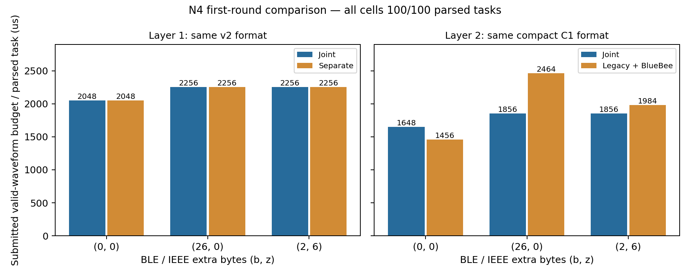

# N4 两层公平对照首轮综合报告

日期：2026-11-13。范围：2401–2406与2411–2416，共12次物理采集；每个格式/负载条件只有1轮，每轮100个不同控制任务，K=1。

## 1. 结论与推进判断

两层首轮功能与成本验证均通过，支持进入下一阶段的软件功能与实验设计。第一层在相同v2记录下证明共包可将物理突发由3次/任务降至2次/任务，但有效波形预算不变；第二层在双方相同C1紧凑编码下观察到成本交叉：零扩展时legacy基线更省，BLE扩展26 B及BLE/IEEE扩展2/6 B时共包分别降低24.7%和6.5%的有效波形预算。

这里的“降低”只针对本报告实现的基线及计数口径，不代表实际RF占用、能耗、物理执行时延或同步精度收益。12轮每轮BLE、IEEE及联合任务解析均100/100；不得把它们汇合为同一条件的1200次独立重复，也不据此宣称高可靠性保证。

## 2. 实验设计与公平性

| 层次 | 实验组 | 基线 | 被控制的内容 | 主要差异 |
|---|---|---|---|---|
| 第一层 | J2：primary＋v2共包secondary | S2：primary＋BLE-only secondary＋独立BlueBee | 两侧36+n B记录、任务、周期、截止字段、信道 | 物理突发组织 |
| 第二层 | JC：primary＋C1共包secondary | LC：legacy BLE记录/分片＋独立BlueBee | 两侧26+n B记录、任务、时间语义、完整blob | 广播封装、分片、BLE信道 |

一个Pluto类SDR顺序发送，两块HackRF分别独立BLE/IEEE解码。IEEE基线是独立BlueBee波形，不是原生O-QPSK发射。两层均500 ms周期、100任务、K=1、有效期ref+2000 ms、执行字段ref+3000 ms；没有执行器事件。完整blob在本侧解码后验证，不跨侧补写。不同run的blob随run种子变化，不是跨轮逐字节相同；比较的是等长、同语义应用任务。

C1通过ref=slot×period及16位相对有效期/执行提前量压缩；其提前量范围为0..65535 ms，本轮任务落在范围内。JC与LC都使用C1，避免将编码压缩收益算作exadv收益。不得跨第一、第二层直接把成本差归因于单一协议变化。

三对第一层与三对第二层的比较均重新通过已记录条件核对，原始输入哈希一致。第一层固件人工标识20261112.1，第二层20261113.1；相同标识不是二进制哈希。两层均记录0.25 m SMA馈线连接、无外接衰减的描述、相同接收设备、4 Msps、LNA16/VGA10及amp关闭。实际分路/接线细节未由这些文字记录完整重建。第一层记录tx_attenuation=10000 mdB；第二层只记tx_power=0dBm。没有功率计证据，0 dBm应作为人工标称值，不能视为实测输出或跨层严格RF等价。

JC的BLE secondary为ch3/2410 MHz，LC的BLE为ch39/2480 MHz；IEEE均ch12/2410 MHz。这是第二层可靠性比较的混杂因素，不能因比较工具的条件核对通过而忽略。LC只发送一个legacy广播信道，未人为给基线乘三成本。

## 3. 每轮结果

| Run | 组 | b/z B | BLE有效 | IEEE有效 | 联合任务 | 单侧/双方失败 | 完成突发 | 有效波形 µs/轮 | padding µs/轮 | 录制 s |
|---:|---|---|---|---|---|---|---:|---:|---:|---:|
| [2401](../python/experiments/20261112_run2401/analyses/n4_fair/plan.report.md) | J2 | 0/0 | 100/100 | 100/100 | 100/100 | 0/0/0 | 200 | 204800 | 2000 | 80 |
| [2402](../python/experiments/20261112_run2402/analyses/n4_fair/plan.report.md) | S2 | 0/0 | 100/100 | 100/100 | 100/100 | 0/0/0 | 300 | 204800 | 3000 | 80 |
| [2403](../python/experiments/20261112_run2403/analyses/n4_fair/plan.report.md) | S2 | 26/0 | 100/100 | 100/100 | 100/100 | 0/0/0 | 300 | 225600 | 3000 | 80 |
| [2404](../python/experiments/20261112_run2404/analyses/n4_fair/plan.report.md) | J2 | 26/0 | 100/100 | 100/100 | 100/100 | 0/0/0 | 200 | 225600 | 2000 | 80 |
| [2405](../python/experiments/20261112_run2405/analyses/n4_fair/plan.report.md) | J2 | 2/6 | 100/100 | 100/100 | 100/100 | 0/0/0 | 200 | 225600 | 2000 | 70 |
| [2406](../python/experiments/20261112_run2406/analyses/n4_fair/plan.report.md) | S2 | 2/6 | 100/100 | 100/100 | 100/100 | 0/0/0 | 300 | 225600 | 3000 | 70 |
| [2411](../python/experiments/20261113_run2411/analyses/n4_compact/plan.report.md) | JC | 0/0 | 100/100 | 100/100 | 100/100 | 0/0/0 | 200 | 164800 | 2000 | 70 |
| [2412](../python/experiments/20261113_run2412/analyses/n4_compact/plan.report.md) | LC | 0/0 | 100/100 | 100/100 | 100/100 | 0/0/0 | 200 | 145600 | 2000 | 70 |
| [2413](../python/experiments/20261113_run2413/analyses/n4_compact/plan.report.md) | LC | 26/0 | 100/100 | 100/100 | 100/100 | 0/0/0 | 500 | 246400 | 5000 | 70 |
| [2414](../python/experiments/20261113_run2414/analyses/n4_compact/plan.report.md) | JC | 26/0 | 100/100 | 100/100 | 100/100 | 0/0/0 | 200 | 185600 | 2000 | 70 |
| [2415](../python/experiments/20261113_run2415/analyses/n4_compact/plan.report.md) | JC | 2/6 | 100/100 | 100/100 | 100/100 | 0/0/0 | 200 | 185600 | 2000 | 70 |
| [2416](../python/experiments/20261113_run2416/analyses/n4_compact/plan.report.md) | LC | 2/6 | 100/100 | 100/100 | 100/100 | 0/0/0 | 300 | 198400 | 3000 | 70 |

“单侧/双方失败”依次为仅BLE、仅IEEE、双方失败，分母均100次计划尝试。由于K=1，每项只有一次尝试，逐任务与逐尝试联合结果相同。2401–2404录制80秒，其余70秒；配对内部一致，且两侧均覆盖全部100槽，不因较短录制判无效。

## 4. 配对成本与物理突发

成本分子为全轮全部成功提交突发的完整有效波形预算，包含primary、secondary或legacy分片和独立IEEE波形；分母为两侧均解析成功的任务数。失败尝试不能删除，本批未出现提交失败/超时。零样本padding单列，静默间隔不算RF发射时间；零样本也不证明零RF能量。

| 配对（实验组/基线） | b/z B | 实验组 µs/成功任务 | 基线 µs/成功任务 | 实验组相对基线变化 | 突发/任务 |
|---|---|---:|---:|---:|---|
| [2401/2402](../python/experiments/20261112_run2402/analyses/n4_compare_2401_2402/comparison.md) | 0/0 | 2048 | 2048 | +0.00% | 2/3 |
| [2404/2403](../python/experiments/20261112_run2404/analyses/n4_compare_2403_2404/comparison.md) | 26/0 | 2256 | 2256 | +0.00% | 2/3 |
| [2405/2406](../python/experiments/20261112_run2406/analyses/n4_compare_2405_2406/comparison.md) | 2/6 | 2256 | 2256 | +0.00% | 2/3 |
| [2411/2412](../python/experiments/20261113_run2412/analyses/n4_compact_compare_2411_2412/comparison.md) | 0/0 | 1648 | 1456 | +13.19% | 2/2 |
| [2414/2413](../python/experiments/20261113_run2414/analyses/n4_compact_compare_2413_2414/comparison.md) | 26/0 | 1856 | 2464 | -24.68% | 2/5 |
| [2415/2416](../python/experiments/20261113_run2416/analyses/n4_compact_compare_2415_2416/comparison.md) | 2/6 | 1856 | 1984 | -6.45% | 2/3 |

百分比=(实验组−基线)/基线，正值表示实验组更贵。第一层突发减少33.3%，有效波形成本减少0%；第二层零扩展增加13.19%，两处较长负载分别减少24.68%与6.45%。这三个负载点只显示已测成本变化，不构成完整吞吐/可靠性边界或最优性证明。

第二层legacy分片实测：2413收到400个BLE分片并完整重组100条命令；2416收到200个分片并完整重组100条命令。两轮均未记录重组未完成、冲突或超时；2412零扩展直接单帧承载26 B记录。因此“当前v2记录超过31 B”不能用作legacy不可行的证据，本对照已经验证了紧凑单帧与分片两个工作点。

## 5. 数据质检与证据边界

- 12轮完整板端日志均通过现行read_plan的逐槽、配置、DMA生命周期和波形预算校验，结束标记齐全。生成100/100；JC/J2/S2的primary均100/100，LC无primary，计数0为预期。
- deadline_miss、dma_timeout、retune_failure均为0；包含AuxPtr的组未记录DMA窗口越界。全部物理突发均启动并完成，发送程度不确定计数为0。
- 24份接收记录均正常结束，未记录幅度截断及队列溢出。第二层12份现存IQ文件大小与已处理样本量一致；第一层12份IQ当前已不在工作区，仅能核验保存的采集统计、逐包记录及分析，无法现在重跑第一层IQ解码。文件长度与无告警不能独立证明USB绝无丢样或RF完全线性；本批所有计划记录均恢复。
- 联合分析与六份配对比较的源文件SHA-256均核验一致。当前报告未重跑全部IQ解码，采用已完成的独立解码结果，重新审计其引用、板端预算和比较条件。
- C1分片重组的IQ时间仅属于单个BLE接收机；未用两个进程墙钟差计算同步精度，也未用DMA完成代理实际RF起点。
- 每配置只完成1轮。当前不输出基于包独立假设的置信区间；主要结果的跨轮置信区间需至少3轮独立重复后按轮次/相关性处理。

## 6. 可用于论文的阶段表述

> 在单SDR发送、双HackRF独立接收的馈线实验中，三个负载点的共包与分别发送方案均实现了每轮100/100联合命令解析。在相同v2记录下，共包将每任务物理突发数由3降至2，有效波形预算不变。在双方使用相同紧凑编码后，零扩展任务的legacy基线成本较低；当BLE侧需要分片时，所实现的exadv共包方案在两个已测负载点将单位成功解析任务的有效波形预算降低24.7%与6.5%。这些结果属于当前格式、拓扑和单轮观测，不代表实测能耗、同步执行精度或普遍可靠性优势。

## 7. 未完成项与下一步

1. 可以进入N5，验证现场真实单侧漏收后的在线失更检测、保守拒绝与重获；不把离线掩码称为真实RF丢包，不要求新增硬件执行测量。
2. N4等预算重发对照尚未开展，当前全部K=1；最大任务速率、截止期内处理和执行成功也未由本报告测量。
3. 最终安排主要工作点至少3轮独立重复、交替顺序，保留全部失败任务；补齐固件哈希及完整接线/功率配置记录；确认第一层IQ是否已有外部备份，否则将其记为原始IQ不可用。
4. 15点容量扫描2301–2315是前置容量证据，本报告重点为两层12轮公平对照，未将前置扫描混作配对重复。N3同轮IEEE补采等既有待办仍保留。

## 8. 可复核附件

- [逐轮CSV](../python/experiments/n4_two_layer_summary/runs.metrics.csv)
- [配对CSV](../python/experiments/n4_two_layer_summary/pairs.metrics.csv)
- [结构化汇总、质检和来源哈希](../python/experiments/n4_two_layer_summary/review.summary.json)
- [实验实施方案](n4_fair_comparison_plan.md)

所有链接均指向现有逐轮或配对报告；源文件未覆盖。汇总生成时间及18个分析/比较输入的哈希见JSON。
