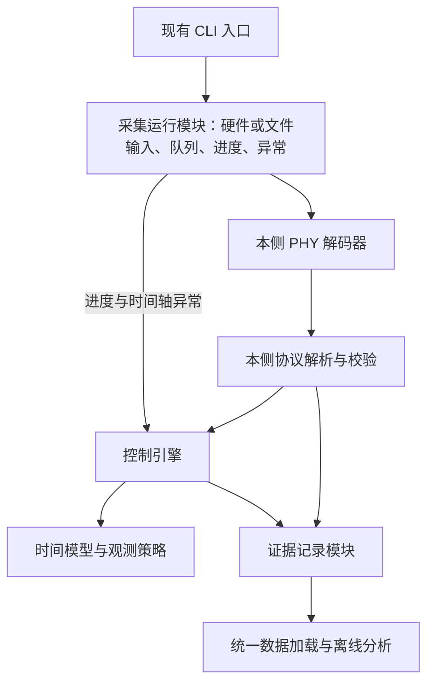

# 接收脚本架构评估与优化方案

> 整理标注（2026-11-18）：技术参考保留原评估时点的描述；其中待办不等于当前未完成项。当前进度与后续安排见[文档导航](../README.md)。

归档日期：2026-11-16。评估基线：`cdf0a2d2cd121b62a8211ce91a599ecc98b2a758`。

状态：架构评估及待实施方案，不是重构完成记录，也不是性能实验结果。承接 [N5 实验方案](../plans/n5_mechanism_experiment_plan.md) 第 3 节软件实现。本次归档不修改接收算法、协议格式或实验统计口径。

## 1. 结论与范围

有必要进行有明确范围的渐进式重构。优先统一采集流程和时间事件接口，再整理协议解析与离线分析基础。当前 PHY 解码器已有可复用的流式接口，控制引擎也已有可独立测试的样本域接口，应保留这些基础。

评估重点是当前独立双接收路径：

| 路径 | 当前职责 |
| --- | --- |
| `python/exadv_rx/receive.py` | HackRF BLE 接收、包记录及可选控制处理 |
| `python/zigbee_rx/control_receive.py` | HackRF IEEE 802.15.4 控制包接收与处理 |
| `python/zigbee_rx/receive.py` | 旧 B2 5A 性能协议接收与序列统计 |
| `python/control_match/` | 控制协议、时间模型、软件事件、回放与联合分析 |
| `python/experiment_tools/` | 设备默认配置、实验归档与报告 |

历史 `ctc_sim/std_zigbee`、`ctc_sim/bluebee` 和 `std_ble` 路径作为用途与依赖对照，不在本次方案中整体迁移。不能仅因目录重组，就将不同接收链的验收地位、波形处理或测量能力视为等价。

## 2. 应保留的基础

- BLE `ChannelDecoder` 与 IEEE `ZigBeeDecoder` 的流式解码接口，以及对应的 IQ 回放测试。
- 控制引擎接受本侧观测、推进样本进度并返回事件的处理方式。
- 原始 packets、events、tasks、配置、源码哈希及统计报告的证据结构。
- 两侧独立采集、独立解码，完成本侧校验后才联合匹配的实验约束。
- 旧性能协议的测试头、填充、Sequence、Run ID 和分母语义。

## 3. 主要问题与依据

以下为源码检查确认的结构事实；其风险是架构判断，不表示已经证实发生无线丢包或错误执行。

| 编号 | 问题与源码依据 | 影响 | 优先级 |
| --- | --- | --- | --- |
| A1 | [BLE 接收入口](../../python/exadv_rx/receive.py) 内的 `Capture` 与 [IEEE 采集模块](../../python/zigbee_rx/hackrf_capture.py) 中的 `Capture` 语法树完全相同；三个接收入口重复管理队列、字节拼接、IQ 转换、异常和收尾 | 采集缺陷修复需要多处同步，两侧及不同实验入口容易产生行为差异 | 高 |
| A2 | 接收入口调用 `advance()` 和 `progress()`；[控制会话](../../python/control_match/live_control.py) 直接调用引擎私有 `_event()` 并访问 `engine.clock`；引擎内部也推进时间 | 因果顺序和状态更新规则分散在调用方；修改进度记录时必须了解时钟内部实现 | 高 |
| A3 | [N5 观测时钟](../../python/control_match/n5_observation.py) 继承 [控制引擎](../../python/control_match/control_engine.py) 中的私有 `_LocalClock`，通过复制拟合字段切换模型；控制引擎反过来识别 N5 配置并创建该时钟 | 拟合算法、实验策略和命令调度相互依赖，新增策略或格式时修改范围扩大 | 高 |
| A4 | [packet_adapter.py](../../python/control_match/packet_adapter.py) 从分析入口 `analyze.py` 导入负载提取函数；[n5_analyze.py](../../python/control_match/n5_analyze.py) 从多个分析入口复用工具函数 | 在线代码依赖离线分析入口，公共能力位置不清楚，入口脚本承担隐含基础库职责 | 中高 |
| A5 | 包、模型与事件主要通过字典传递，字段含义由调用方掌握，包括 `sample_start`、`available_sample`、段号、校验状态和证据模式 | 缺字段、时间域混用及模式误标难以在统一接口处发现；同一负载存在重复解析与校验 | 中高 |
| A6 | [plan_analyze.py](../../python/control_match/plan_analyze.py) 的 `load_side()` 按 command 分别调用 `read_side()` 扫描文件；N5 的命令 0 加六任务会使同侧包文件扫描七遍，之后分析入口还会全量读取 | 分析开销随任务数及记录量增加，解析与统计逻辑重复运行 | 中 |
| A7 | 直接脚本导入、包导入、`sys.path` 修改与导入回退混用 | 启动方式和测试环境影响模块解析，不利于统一复用及打包 | 中 |

评估时对 A7 做过入口检查：`PYTHONPATH=python python3 -m exadv_rx.receive --help` 因找不到 `decoder` 失败；同方式运行 `zigbee_rx.control_receive --help` 成功。这不表示当前文档中的直接脚本启动命令失效。

函数长度仅用于定位职责集中处，不作为重构的单独理由：评估基线中 BLE `main()` 为 205 行，IEEE 控制 `main()` 为 193 行，N5 `run_analysis()` 为 153 行。需要拆分的是其中混合的生命周期、数据校验、策略和输出职责，而不是为了缩短行数增加转发层。

## 4. 目标职责关系

以下为建议结构，不是已经存在的新目录或接口承诺。实现时优先复用现有模块，只为真实存在的变化建立可替换接口。

共享采集模块只意味着复用代码。两侧仍分别创建实例、运行独立接收进程、使用各自设备和 IQ，不共享已解码命令以补全另一侧负载。

建议接口需明确以下责任：

- 采集运行模块统一管理输入生命周期、块拼接、格式转换、处理进度和结束原因；硬件输入与文件输入可替换，不能混淆实时溢出与离线背压。
- PHY 解码模块只负责本侧波形处理与 PHY 结果，保留协议特有算法及校验。
- 协议模块集中完成封装提取与应用记录校验，提供可审计的解析结果；避免各调用方重复解释同一字段。
- 时间模型模块提供拟合、预测和模型快照；N5 观测策略管理候选槽、固定留出、更新时间和恢复窗口。控制引擎消费其结果，不读取或复制私有拟合字段。
- 会话层提交观测、进度和异常，保存返回事件，不自行构造引擎内部状态事件。推进顺序及同一样本进度重复提交的行为由接口明确规定。
- 为包观测、时间轴异常、模型快照及命令事件定义明确的数据结构。必须区分包起点、解码可用进度、主机处理时间、段号和 live/replay/synthetic 模式；不能把不同时间基准简化为无语义的统一 timestamp。
- 离线分析统一加载与校验一次记录，再按槽号、命令建立索引。N3/N5 入口选择策略和组合报告，公共解析、统计及绘图能力不依赖某一实验入口。

## 5. 分阶段实施与交付

所有阶段目前均为待实施。先固化现有版本及代表性 IQ/事件轨迹，形成可回退的基线；每一步通过验证后再迁移下一部分。

| 阶段 | 内容 | 交付与验收重点 |
| --- | --- | --- |
| R0：基线固化 | 固定源码版本、依赖环境、配置及已有代表性 IQ/逐事件输入，保存输入和预期结果哈希 | 明确每份证据的来源、格式、采样率、起始偏移、模式及适用范围；没有的硬件证据不补造 |
| R1：统一采集流程 | 抽取重复 `Capture`、IQ 转换、队列与收尾处理；统一导入方式，现有 CLI 保留为薄入口 | 两侧使用独立实例；正常 EOF、分块边界、溢出、停滞、截断和中断有一致且可审计的处理；旧命令和输出兼容 |
| R2：时间事件接口 | 独立时间模型，隔离 N5 观测策略，消除会话对私有状态的访问，定义观测和事件结构 | 相同观测顺序得到相同模型训练集、探测结果、状态转换和命令事件；未知参考界继续拒绝定时处理 |
| R3：解析与分析基础 | 协议提取下沉、统一加载和索引、统计与报告解耦 | 六任务及零接收任务、四象限、恢复删失、探测覆盖率和成本分母保持一致；原有分析入口继续可用 |

不把 PHY 算法调整、v2/C1 时间语义扩展或性能优化混入纯结构迁移。若确需改变行为，单独说明原因、影响范围和验证证据。

## 6. 验证要求

1. **解码等价性**：相同 IQ 的包内容、校验结果、顺序及采样位置保持一致；浮点容差如有需要须事先说明，不能通过扩大容差隐藏行为变化。
2. **因果与时间轴**：延迟可用的训练包不能影响此前探测；探测永不参与训练或重获计数；无包期间按样本进度检测失更；重启另起段，不平移历史 IQ。
3. **控制行为**：重复、冲突、乱序、错误目标、未知操作码、CRC 错误、过期及未知参考拒绝保持原规则；有界输入下的冻结、取消等分支使用显式合成证据。
4. **采集故障注入**：使用模拟输入覆盖队列溢出、停滞、残缺样本、正常 EOF、用户中断及异常退出；检查异常不会被报告为正常无线漏收。
5. **统计等价性**：保留计划任务分母、全部未收到任务、一次发送与重发口径、未恢复事件及缺失探测；零分母仍为 N/A。
6. **证据可追溯性**：保留输入与源码哈希、配置、设备角色、逐包和逐事件记录；需要改变 schema 时明确版本与兼容读取方式。
7. **独立接收约束**：共享库不共享无线观测；同 IQ 双解码、独立双接收和离线合成分别标注。软件回归通过不替代硬件接收验证。

已有 PHY 回放、控制引擎和 N5 合成测试可作为基线，但不能单凭测试数量宣称采集生命周期或长时间硬件运行已经得到充分验证。此次架构评估未重新执行完整测试套件，也未进行硬件性能测量。

## 7. 性能待测项与范围限制

代码检查显示同步 JSON 写入、频繁 `flush()`、重复负载解析及重复文件扫描值得测量。现有块处理耗时统计未覆盖全部外层工作，例如在 `process()` 之后执行的 N5 `control.progress()`。这些都是待测项，尚不能判定其为实时接收瓶颈。

如开展性能测量，应在相同 IQ 和配置下分别记录解码、控制处理、事件序列化/写入、完整块处理耗时、处理速率及队列高水位；同时保存硬件接收中的溢出与截断信息。性能收益须有前后测量支撑，不能从模块拆分直接推导。

当前不建议仅为架构整洁引入多进程、通用异步框架或重写 PHY。优先完成 R1/R2，使后续 N5 实验扩展集中在策略与分析模块，并降低证据语义随脚本变化而漂移的风险。
