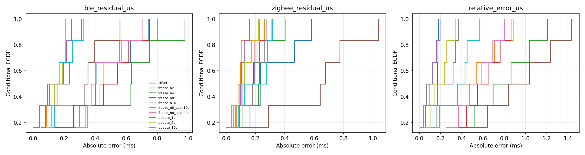
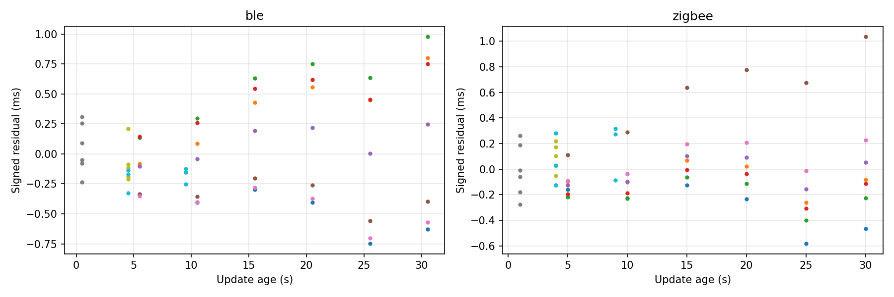
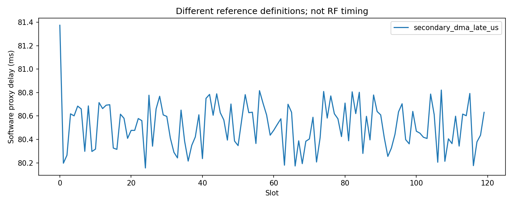

# N3 相对预测与软件取时分析

Run 2101；探索性分析：True；取时：legacy_missing_stages。
计划 120 槽，预定探测 6 槽；BLE/IEEE有效 120/120。

|策略|相对差有效/计划|绝对差中位数 µs|P95 µs|最大 µs|
|---|---:|---:|---:|---:|
|offset|6/6|170.500|177.938|178.750|
|freeze_n2|6/6|448.734|839.231|882.539|
|freeze_n4|6/6|778.917|1162.694|1205.255|
|freeze_n8|6/6|601.823|837.536|863.644|
|freeze_n16|6/6|108.294|185.695|194.213|
|freeze_n8_span10s|6/6|939.343|1385.052|1434.661|
|freeze_n8_span20s|6/6|528.492|771.838|798.962|
|update_1s|6/6|191.792|361.940|368.942|
|update_5s|6/6|186.510|316.894|336.668|
|update_10s|6/6|392.457|538.935|568.869|

单侧残差、模型训练槽、更新年龄、阈内计数和缺失数见 CSV/JSON。冻结配置中的探测包不会更新模型。
原始 tick 先以整数相减再转换；历史缺失阶段保持缺失，不能用平均值回填。
此结果不是绝对同步、RF AuxPtr精度或物理执行证据；小样本 P99 不构成尾部保证。
