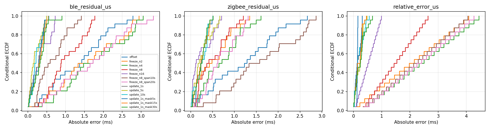
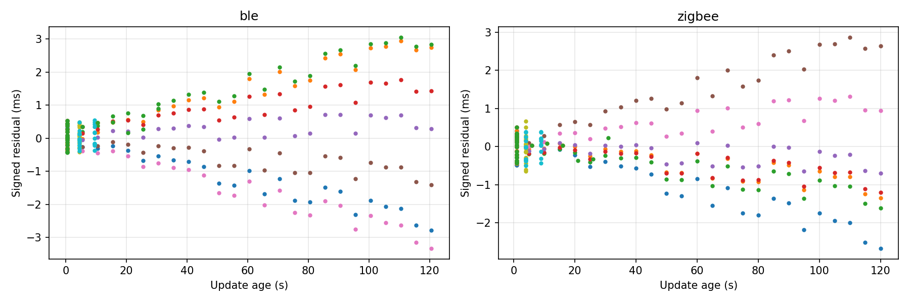
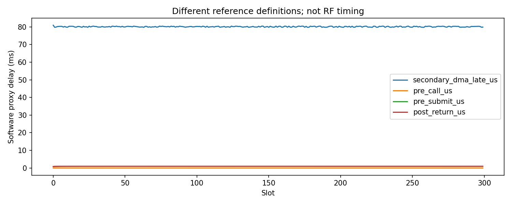

# N3 相对预测与软件取时分析

Run 2201；探索性分析：False；取时：complete_software_trace。
计划 300 槽，预定探测 24 槽；BLE/IEEE有效 300/300。

|策略|相对差有效/计划|绝对差中位数 µs|P95 µs|最大 µs|
|---|---:|---:|---:|---:|
|offset|24/24|135.250|151.025|152.250|
|freeze_n2|24/24|2063.387|3883.333|4085.546|
|freeze_n4|24/24|2410.885|4239.741|4442.944|
|freeze_n8|24/24|1486.208|2522.798|2637.973|
|freeze_n16|24/24|518.940|938.980|985.651|
|freeze_n8_span10s|24/24|2208.459|3870.294|4054.939|
|freeze_n8_span20s|24/24|2330.696|4075.177|4269.005|
|update_1s|24/24|137.349|304.759|307.281|
|update_5s|24/24|222.708|425.346|475.724|
|update_10s|24/24|147.907|438.948|552.365|
|update_1s_mask5s|24/24|129.858|307.011|309.089|
|update_1s_mask15s|24/24|184.494|370.367|453.022|
|update_1s_mask30s|24/24|241.441|585.712|668.801|

单侧残差、模型训练槽、更新年龄、阈内计数和缺失数见 CSV/JSON。冻结配置中的探测包不会更新模型。
原始 tick 先以整数相减再转换；历史缺失阶段保持缺失，不能用平均值回填。
此结果不是绝对同步、RF AuxPtr精度或物理执行证据；小样本 P99 不构成尾部保证。
