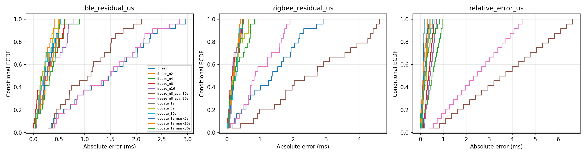
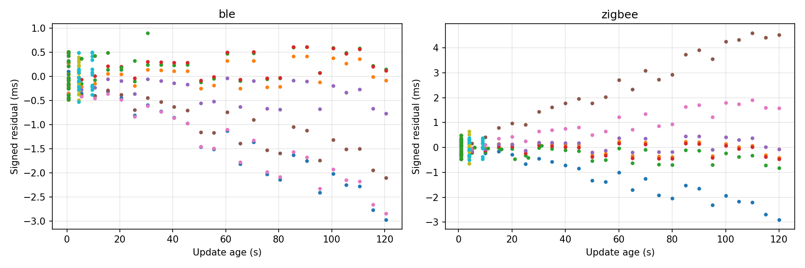
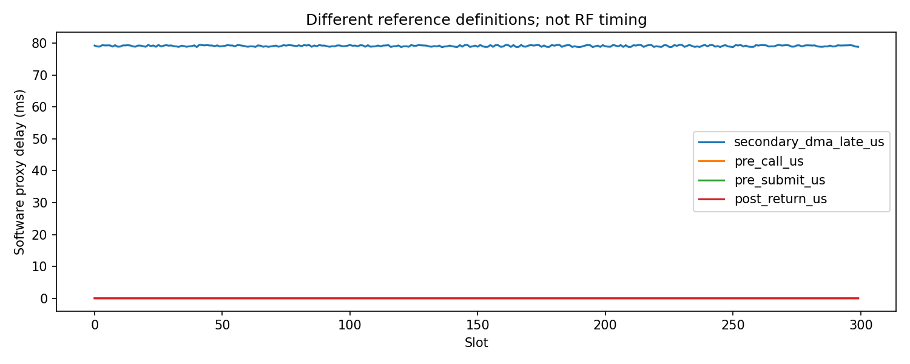

# N3 相对预测与软件取时分析

Run 2203；探索性分析：False；取时：complete_software_trace。
计划 300 槽，预定探测 24 槽；BLE/IEEE有效 300/300。

|策略|相对差有效/计划|绝对差中位数 µs|P95 µs|最大 µs|
|---|---:|---:|---:|---:|
|offset|24/24|115.750|160.825|165.250|
|freeze_n2|24/24|119.482|297.174|320.368|
|freeze_n4|24/24|521.810|935.484|981.641|
|freeze_n8|24/24|353.685|573.291|597.886|
|freeze_n16|24/24|423.477|674.548|702.250|
|freeze_n8_span10s|24/24|3594.258|6322.735|6625.698|
|freeze_n8_span20s|24/24|2404.190|4223.567|4425.521|
|update_1s|24/24|157.296|326.201|371.419|
|update_5s|24/24|259.584|383.559|453.583|
|update_10s|24/24|171.360|498.671|527.740|
|update_1s_mask5s|24/24|147.221|357.685|371.419|
|update_1s_mask15s|24/24|209.270|445.974|552.322|
|update_1s_mask30s|24/24|240.946|725.894|833.147|

单侧残差、模型训练槽、更新年龄、阈内计数和缺失数见 CSV/JSON。冻结配置中的探测包不会更新模型。
原始 tick 先以整数相减再转换；历史缺失阶段保持缺失，不能用平均值回填。
此结果不是绝对同步、RF AuxPtr精度或物理执行证据；小样本 P99 不构成尾部保证。
