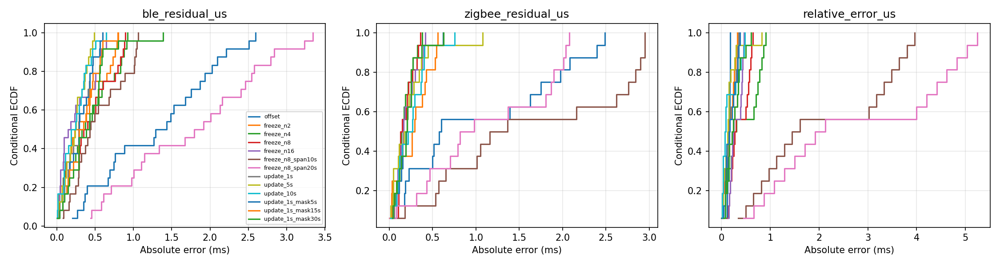

# N5 软件观测与机制分析

Run 2511；联合命令解析 4/6；参考质量 uncalibrated。
所有定时事件均为本侧 IQ 样本域软件事件；immediate 为 available_sample 回放，未评估截止时间。

|侧|记录模式|探测评分/计划|失更后恢复/失更事件|
|---|---|---|---|
|ble|['live_software']|24/24|0/1 (0.0)|
|zigbee|['live_software']|16/24|1/2 (0.5)|

逐槽四象限、全六任务、缺失边界、恢复删失及逐探测原因见 CSV；未恢复事件保留在恢复分母。
时间轴异常：{"ble": [], "zigbee": []}
成本沿用 summary.integrity 的板端代理口径；包含同步槽和失败尝试，不能解释为已测 RF 发射时刻。

Replay is not live evidence; immediate deadlines are not assessed.
Missing decode causes remain undetermined; DMA is only a transmission proxy.
No calibrated cross-device clock, RF start or actuator precision is measured.
Anomalous timelines are excluded from replay precision scoring.
No hardware-loss warning does not establish gap-free IQ.
24 probes per policy give descriptive tails, not independent repeated experiments.
