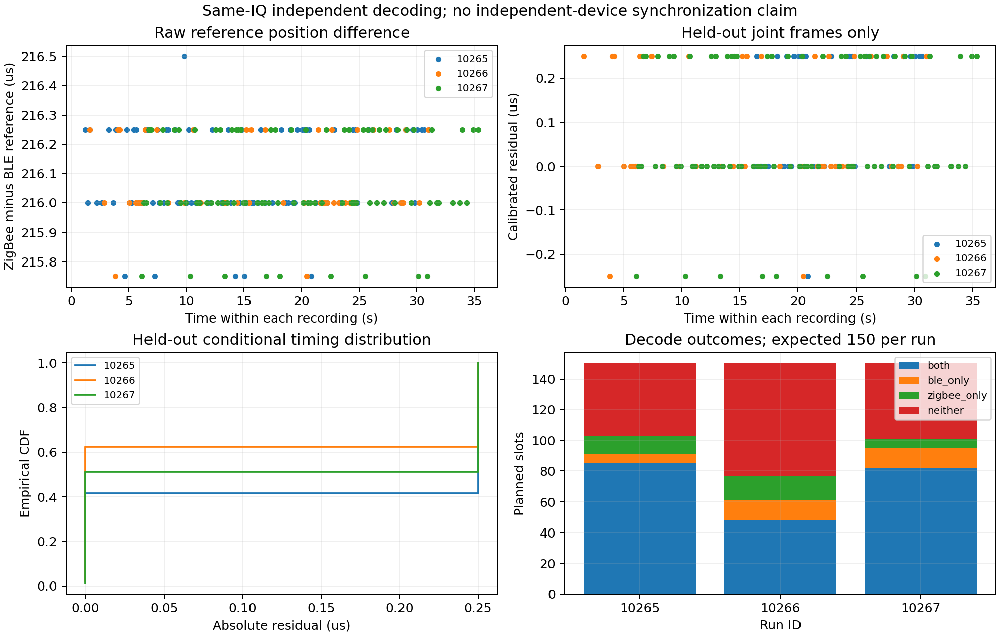

# 已保存 IQ 的共同包时间参考验证结果

日期：2026-10-27。结论：三份 IQ 都能由两条独立算法链恢复同一包的身份和完整负载；按包结构补偿后，成功配对样本的时间参考差异很小。验证对象是同一 IQ 的包参考一致性，尚未测试独立设备同步、同步控制字段或执行器动作。

## 输入与方法

| Run ID | IQ 来源 | payload | IQ 时长 | 计划序列 |
| --- | --- | --- | --- | --- |
| 10265 | `python/exadv_rx/results/rx_20261026_161955_853914.ci8` | 30 B | 40 s | 0..149 |
| 10266 | `python/exadv_rx/results/rx_20261026_162114_151247.ci8` | 40 B | 40 s | 0..149 |
| 10267 | `python/zigbee_rx/results/rx_20261027_104502_973395.ci8` | 30 B | 40 s | 0..149 |

每份为 8 Msps、2480 MHz、640 MB ci8，分别完整回放给现有 BLE 与 ZigBee 接收器。原始 IQ 和两侧接收代码未修改。另一个 1733 B 文件是设备打开失败时产生的记录，不作为有效 IQ。

BLE 链通过 BLE CRC 后，从自身已恢复的 Manufacturer AD 精确解析 BlueBee 编码，检查内嵌 PHY FCS、测试头和完整填充；ZigBee 链只从自己的 IQ 进行标准 DSSS 解调和校验。BLE 结果没有送入 ZigBee 解调器。完成解码后按 Run ID+Sequence 匹配，还要求完整 PHY 帧逐字节一致；没有给缺失帧补数据或猜时间。

三份输入的身份校验异常、完整帧不一致、重复身份导致的时间配对歧义和越界 Sequence 均为 0。命令、输入 SHA-256、源码与产物散列见 `validation.manifest.json`。

## 完整计划范围内的结果

| Run ID | BLE 唯一有效 | ZigBee 唯一有效 | 两侧均有效 | 仅 BLE | 仅 ZigBee | 两侧均缺失 | 共同恢复／计划 |
| --- | --- | --- | --- | --- | --- | --- | --- |
| 10265 | 91 | 97 | 85 | 6 | 12 | 47 | 85/150 = 56.67% |
| 10266 | 61 | 64 | 48 | 13 | 16 | 73 | 48/150 = 32.00% |
| 10267 | 95 | 88 | 82 | 13 | 6 | 49 | 82/150 = 54.67% |

共 215 个完整帧一致的配对样本。两条解码链分别存在单侧恢复情况，不能用一侧代替另一侧，也不能将两侧恢复率相乘作为共同恢复率。这里分母 150 为预先配置的计划序列范围，尚未合并板端最终发送计数，不作为正式无线 PRR。

特别地，Run 10267 的 BLE 95 包来自对 ZigBee 目录下同一录制的离线解码，不是另一块 HackRF 同时实测得到的 BLE 接收记录。

## 结构偏移及校准

两侧时间戳检测的包内位置不同。逐包解析 BLE PDU 得到：

```text
BLE preamble + AA                       5 B
BLE PDU header                          2 B
extended header length/mode + header   10 B
Flags AD                                3 B
Name S AD                               3 B
Manufacturer AD prefix                  4 B
-------------------------------------------
BLE 包起点到 BlueBee/ZigBee 前导码       27 B
```

因此 LE 1M 下理论时间位置差为 `27 * 8 = 216 us`。其中 PDU 内 BlueBee 起点偏移为 22 B。该值由字节布局解析获得，不是通过拟合两侧时间差获得。三轮布局相同，因此 30/40 B 数据都使用同一个结构偏移。

预先固定 Run 10265、Sequence 0..74 为校准分区，其中两侧共同有效 49 包。以这些包的结构补偿残差中位数估计固定偏差，结果为 **0 us**。没有逐包对齐，也没有对验证分区重拟合偏移或斜率。现阶段结构补偿已经解释主要位置差，额外固定校准没有产生数值改进。

## 时间参考结果

原始 `t_ZigBee - t_BLE`：Run 10265 范围 215.75..216.50 us；另两轮均为 215.75..216.25 us；三轮中位数均为 216 us。

验证分区结果如下，误差为扣除结构偏移及固定校准量之后的残差。统计只对两侧均成功且完整帧一致的样本计算；分位数指绝对残差。

| 验证分区 | 配对 n | 平均残差 / us | 标准差 / us | 绝对 P95 / us | 绝对 P99 / us | 最大绝对残差 / us |
| --- | --- | --- | --- | --- | --- | --- |
| 10265，Sequence 75..149 | 36 | 0.1319 | 0.1380 | 0.25 | 0.25 | 0.25 |
| 10266，全轮 | 48 | 0.0729 | 0.1346 | 0.25 | 0.25 | 0.25 |
| 10267，全轮 | 82 | 0.0671 | 0.1612 | 0.25 | 0.25 | 0.25 |
| 合并描述性统计 | 166 | 0.0828 | 0.1513 | 0.25 | 0.25 | 0.25 |

验证分区残差均在 -0.25..0.25 us，不能称为平均误差为零。若将校准分区也计入，全体 215 个共同包的最大绝对残差为 **0.5 us**，该点位于 Run 10265 校准分区，未删除。

为避免忽略失败，预设 0.25 us 容差时，同时要求两侧完整恢复、参考残差达标的数量／该验证分区全部计划时隙为：

- 10265 后半段：36/75 = 48.00%。
- 10266：48/150 = 32.00%。
- 10267：82/150 = 54.67%。
- 合并描述：166/375 = 44.27%。

这不是同步执行成功率。当前样本中所有共同有效验证帧都达到了该参考残差容差，因此这一统计主要受共同解码缺失限制；不能因条件残差很小而忽略较低的恢复比例。分组数据具有相关性，合并值只用于描述，不作为独立同分布样本的显著性结论。



## 能否开始后续同步实验

可以继续。当前证据支持：在相同 IQ 中，依据包布局，两条算法能一致地恢复共同包参考点；30/40 B 和不同录制之间不需要逐轮重新居中。

但 **0.25 us 不能写为双 HackRF 同步精度**。两条算法共享同一采样时钟、RF 观测和原始时间轴，误差可能相关；结果还体现内部采样网格量化。没有测试两块设备的起始偏移、独立采样率漂移或真实控制执行。8 Msps 的样本周期为 0.125 us，也不意味着达到相应绝对精度。

下一步优先取得两块不同序列号 HackRF 的同轮独立 IQ，并记录共同任务标识及板端计数，先验证四种联合接收结果。之后校准两路采样时间轴，才评估设备间时间参考误差和定时控制。当前同步字段、目标执行时刻及重复/过期规则尚未加入包格式，本结果不能替代这些机制的实验。

## 可复查材料

- 方法及重放入口：`python/sync_validation/README.md`、`validate_saved_iq.py`。
- 输入及校准分区：`recordings.config.json`。
- 机器摘要：`reference_validation.summary.json`。
- 全部 450 个计划序列：`per_sequence.metrics.csv`，保留缺失、校准和验证标记。
- 图表：`reference_validation.png`、`reference_validation.pdf`。
- 重放命令及散列：`validation.manifest.json`。

4 项分析回归测试通过，覆盖 BLE 独立身份/布局解析、坏内嵌帧拒绝、严格时间配对及校准不使用验证数据。另已核对源码和图表/CSV 散列，以及 450 个计划行、215 个完整帧配对、49/166 校准/验证计数。
